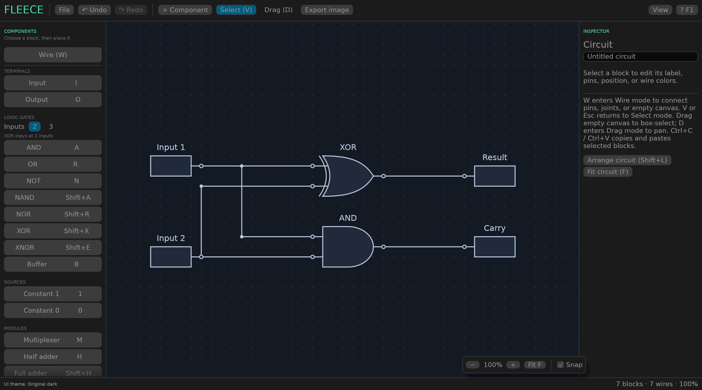
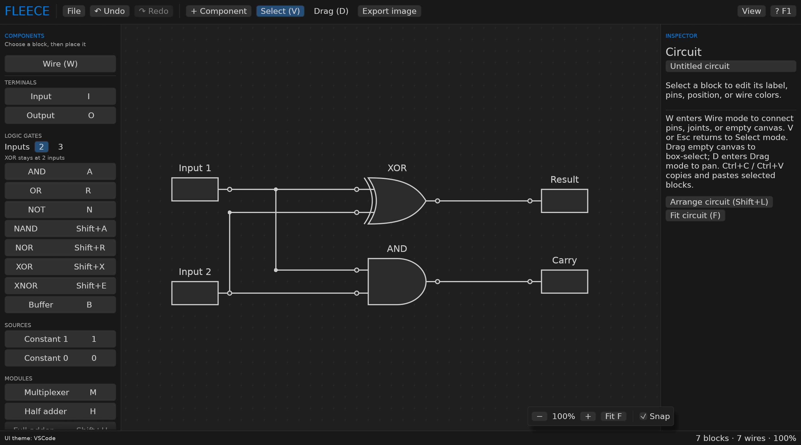
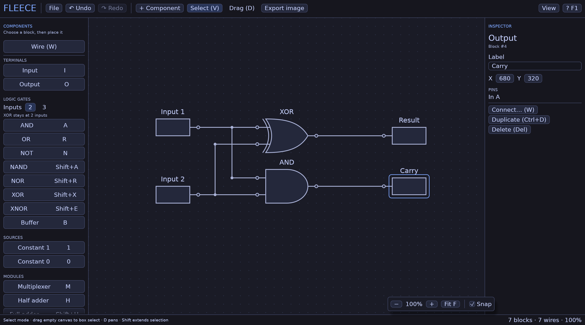

# FLEECE



A Rust editor for drawing digital logic circuits and finite state machines,
available on desktop and in the browser.
Create circuits visually or from the keyboard, save editable
TOML documents, and export a clean diagram for your report.

## Run

Requires Rust **1.95 or newer** and a desktop with a Vulkan, OpenGL, Metal, or DX12
graphics driver. Linux builds support Wayland and X11.

```sh
cd /path/to/FLEECE
cargo run --locked
```

The app starts with an empty logic circuit. **File → New → Logic Circuit / FSM**
creates the selected diagram type; **Ctrl+N** opens the same choice. Open a saved
document or an example explicitly:

```sh
cargo run --locked -- examples/half-adder.toml
```

Export a saved document without opening a window using compiler-style `-o`:

```sh
cargo run --locked -- examples/half-adder.toml -o /tmp/half-adder.png
cargo run --locked -- examples/fsm.toml -o /tmp/fsm.svg
```

Use `--output` as an alias for `-o`; options may precede the input path. The output
extension chooses PNG or SVG. Existing output images are replaced atomically.
`--help` shows usage. Errors print to stderr and return exit status 1.

For a faster application after the initial build:

```sh
cargo build --release --locked
./target/release/fleece
```

## Run in a browser

The WebAssembly build shares the desktop editor, including circuit/FSM editing,
undo/redo, wiring, navigation and PNG/SVG rendering. Files are imported through a
browser picker or drag-and-drop, while saving and exporting download files.
Theme preferences and recent download names stay in browser local storage.

```sh
rustup target add wasm32-unknown-unknown
cargo install wasm-bindgen-cli --version 0.2.129 --locked
./scripts/build-web.sh
python3 -m http.server 8080 --directory web
```

Open <http://localhost:8080>. See [web/README.md](web/README.md) for build-tool
versions, static hosting, browser behavior and verification. Browser preferences
are separate from native config/state files. Browser save initiates a download;
it does not grant FLEECE permission to overwrite files on disk.

The [examples directory](examples/README.md) includes editable circuits and an FSM,
with PNG/SVG previews regenerated from the current documents.

## Edit a finite state machine

Choose **File → New → FSM**. Press **S** (or **+ State**) to place states with
repeated clicks or **Enter**; arrow keys move the placement cursor. Press **W**
(or **Wire**) and click source/destination states to add transitions. Choosing
the same state creates a loop. **T** remains an alias for transition mode.

FSMs use the circuit editor's controls: **V** or **Esc** selects; drag empty canvas
to box-select, **D** toggles Drag mode for panning, **Shift** extends selection, and dragging
states or using arrow keys moves them. Right-click a state or transition to
remove it. **Ctrl+A/X/C/V/D** selects all, cuts, copies, pastes, or duplicates states and
their internal transitions. **Ctrl+Z** / **Ctrl+Shift+Z** undo/redo. **F** fits the
diagram and **Shift+L** arranges states. Transitions follow their states.

The inspector edits state names, positions, initial states (incoming arrow), and
accepting/final states (double circle). State outputs support Moore-style
annotations. Transition endpoints, conditions/inputs, and outputs can be edited;
Mealy-style transition labels appear as `condition / output`. These are diagram
annotations, not executable expressions or FSM simulation.

Save and reopen FSMs as TOML using **Ctrl+S** and **Ctrl+O**. Export PNG or SVG with
**Ctrl+E**; exports contain the diagram independently of the theme and viewport.
See [the editable example](examples/fsm.toml).

FSM data lives in `[circuit.fsm]`, with `states`, `transitions`, and an optional
`initial` state ID. FSM documents have empty circuit `nodes` and `wires`; existing
logic documents retain their format. The editor provides diagram editing and
export without simulation or truth-table generation.

## Draw a circuit

1. Choose a component from the library, press its shortcut, or search with **Ctrl+K**.
2. Click repeatedly to place copies of that component. Placement stays active until
   **Esc** returns to regular selection. Press another component shortcut to switch
   types. You can also use arrow keys and **Enter** repeatedly without a mouse.
3. Press **W** or choose **Wire** in the components panel to add connections. Click a pin or joint, then
   another pin or joint. Click empty space to start or extend a wire through
   suspended joints. Each empty-space click extends the current wire. Existing
   connections stay intact when starting another branch from a connected pin.
4. Press **V** or **Esc** for regular **Select** mode. Click nodes, pins, or wires
   to select them; drag a node to move it. Drag empty canvas to box-select;
   hold **Shift** to extend the selection. **D** toggles Drag mode, which pans
   when dragging anywhere. **Shift+click** adds/removes nodes from selection.
   Regular-mode left-clicks never add or disconnect wires. Right-click a component
   or joint to remove it, or a wire/pin to disconnect it; **Ctrl+Z** undoes.
5. Save with **Ctrl+S**. Export with **Ctrl+E** when the diagram is ready.

Save and Save As open at the current file's location when available. New documents
start in the folder of the last successful save, including after restarting the
native app. New circuit/FSM filenames default to `circuit.toml` / `fsm.toml`.
Save/export history lives separately from circuit and FSM documents. On Linux,
the app creates `~/.local/state/fleece/state.toml` on the next
successful save or export (or `$XDG_STATE_HOME/fleece/state.toml`
when an absolute override is set). Recent locations are persistent application
state under the [XDG Base Directory Specification](https://specifications.freedesktop.org/basedir/0.8/).
The file remembers the last save path, last export path/format, and export
settings: scale, transparency, title and padding. User-selected themes are
recorded separately in `~/.config/fleece/config.toml`, without saving a document. Export dialogs
reopen at the last successful export; without one, they start beside the current
or last saved document. Cancelled or unsuccessful operations do not replace the
remembered values.

Automatic labels number inputs and outputs independently: `Input 1`, `Input 2`,
and `Output 1`, `Output 2`. Gates/modules keep plain names such as `AND` or
`D-flip-flop`. Names do not need to be unique; manual renaming, duplication and
clipboard paste preserve the names you chose.

Available components:

| Group | Components |
| --- | --- |
| Terminals | Input, output, constant 0, constant 1 |
| Gates | AND, OR, NOT, NAND, NOR, XOR, XNOR, buffer |
| Modules | 2:1 / 4:1 / 8:1 multiplexer, half adder, full adder, D-flip-flop, custom module |

Choose **2** or **3** inputs in the components panel before placing AND, OR,
NAND, NOR, or XNOR gates; their inspector also supports **2–6 inputs**. XOR stays
at **two inputs**. Unary NOT and buffer gates keep one input.
Custom modules support **2–6 inputs** and **1–4 outputs**; the inspector edits
their diagram properties.

Select a logic gate and use **Inversion bubble** under each pin in the inspector,
or **Alt+click** the pin, to add or remove a bubble. Input bubbles annotate an
inverted input; an output bubble changes AND/OR/XOR/buffer to
NAND/NOR/XNOR/NOT. Bubbles persist in TOML and appear in both
the editor and PNG/SVG exports.

Select blocks and press **Ctrl+C** to copy or **Ctrl+X** to cut, then **Ctrl+V**
to paste them in the same
circuit or another document. Internal wires, joints, colors, module port counts
and bubbles are preserved. Pasted blocks get new IDs and
are selected together near the mouse cursor. Repeated pastes at the same cursor
position get a small offset; moving the cursor starts a new paste location. Each cut and paste is one undoable action. Text fields keep normal text cut/copy/paste.

Pins automatically connect when you place, paste or finish moving a component
with a pin exactly on a wire or joint. Wires split into a shared joint as needed;
existing routes and bus annotations are preserved. Inputs with existing wiring
keep their connection. Outputs can drive suspended wires/joints; another output's
driven net and ambiguous crossings of unrelated nets are left unchanged. The
connection is part of the placement/move/paste undo action. Clicking alone does
not connect anything.

In **Wire mode (W)**, click a wire segment once to insert a **joint**. Click a joint, then an input pin
to add a branch; repeat to attach more wires to the same joint. You can also
start at an input pin and finish at a joint or wire. Joints are saved connection
points with no component body or label. All joints, including routing controls
and automatic elbows, show solid dots while editing.
PNG/SVG exports hide dots for joints with exactly two wires; suspended endpoints
and branches keep their solid dots.
Right-click a wire to disconnect only that segment. Right-click an input pin to
disconnect its incoming wire, or an output pin to disconnect its outgoing branches.
Components and the wires on their other pins stay in place. **Ctrl+Z** restores
these connections.
Removing a joint drops its duplicate routing controls and preserves the other
corners, including automatic elbows farther along the wire.
Dragging a joint moves every attached wire endpoint together while other joints
and pins stay fixed. Dragging a routing control or automatic elbow makes it a
persistent joint in the same undoable action; clicking alone only selects it.
Drag horizontal wire segments vertically and vertical segments horizontally to
reshape routes while keeping their connections.

In Wire mode, click empty canvas to start at a free joint, or to extend the
current wire to another **suspended joint**. The endpoint is saved and can be dragged, extended, or connected later.
This works when starting at either an input or an output. A suspended source
feeding an input remains unknown until it is connected to a driver. Press **Esc**
to cancel a wiring preview without creating an endpoint.

Shift+click and box selection include joints alongside blocks; drag or use arrows
to move the selection together. Existing routing controls and automatic bends
can also be selected and dragged, and become shared connection joints when you
move or branch from them. In regular mode, click a wire to edit its routing coordinates,
color, or reset its route in the inspector. Select a joint and press **Delete**
to remove it while preserving its wire connections. Edits support undo/redo and
are saved in TOML. With snapping enabled, pins and dragged joints align to grid
intersections.

To mark a wire as a bus, enter **Select mode (V)**, select the wire, enable
**Bus annotation** in the inspector, and set **Width** (1–1024). A diagonal slash
and width are drawn on the wire in both the editor and PNG/SVG exports. Disable
the annotation to return to a plain wire. In Select mode, drag either the slash
or its width to slide it along the route, around elbows, and across connected
joints onto another branch. Unrelated crossings are not connected destinations.
A matching destination marker is merged; a different width is preserved.
The saved position appears in exports too. Each drag is one undo action.
The setting supports undo/redo and
persists through saving, copying and joint edits. This labels the wire without
changing its endpoint ports. Register symbols no longer show an `N bits` caption;
their **Bits** inspector control still configures the diagram's pin count.

In TOML, a shared joint is a node with `kind = "joint"`, one input and one output
at the same position. Connect one incoming wire to its input and any number of
outgoing wires from its output. These pins forward the same signal; each net
retains a single driver. Regular wires use their start and end pins plus a
`horizontal_first` flag (default `true`). They have at most one elbow: horizontal
then vertical, or vertical then horizontal. Select a wire in regular mode and toggle
**Horizontal first** in the inspector to choose its direction. That control
returns a manually routed wire to a single elbow. Explicit `waypoints` remain
supported as explicit routing controls.
While drawing, the first mouse movement after choosing a starting point locks
the segment's initial axis: mostly sideways selects horizontal first; mostly
up/down selects vertical first. Each new segment makes its own choice. The
preview and saved wire use the same direction, including input-first drawing.

FLEECE is a diagram editor. Input values, output values, register pulses and
live signal coloring are not features. Documents store only diagram structure
and annotations; loading never evaluates logic or changes diagram data.

## Diagram style and labels

The editor retains its original canvas: sans-serif labels, rectangular terminal
blocks, visible connection pins, a configurable grid, and explicit wire colors.
UI themes control the editor's colors.

**Exported PNG/SVG diagrams** use the reference style: white paper, classic gate
outlines, serif math labels, and plain input/output wire stubs with their names
above the wires. Export appearance is independent of the UI theme.

Exported labels support a small set of math notation. The editor shows the
original label text so the notation remains easy to edit:

| Label text | Meaning |
| --- | --- |
| `s_0`, `s_{10}` | Subscript |
| `s_1'` | State bit with a prime |
| `x^{2}` | Superscript |
| `\bar{s_1}`, `\overline{Q}` | Overbar |
| `\cdot`, `\oplus`, `\land`, `\lor` | Logic/math symbols |
| `\_` | Literal underscore |

This is lightweight label formatting, not a full LaTeX engine. Module headings
use bold serif text. The application controls retain a sans-serif font.

Select a wire and choose its color in the inspector, or choose a color under a
block's output pin. These are **export colors**: black, red, green, blue, purple,
and amber. A color applies to every branch from that output in both the editor
and exports and is saved with the circuit. Default wires use the theme outline color.
Exported junction dots indicate shared branches; a crossing of unrelated nets
does not create a connection.

## UI themes

**Fleece:**


**VSCode:**



**Tokyo Night:**



New documents use **Original dark** with a visible grid, dark component bodies,
and contrasting light outlines/pin labels. Choose **View → Theme**
to switch to VSCode, Tokyo Night, Original light, or a custom theme. Successful
changes are remembered immediately in `~/.config/fleece/config.toml` and
applied to new documents and future app launches. Failed theme loads preserve
the previous choice. Documents still retain their `[editor].theme` reference for
use when no app preference exists.

Themes are stored in `~/.config/fleece/themes/` (or the equivalent location
under an absolute `XDG_CONFIG_HOME`). On native startup, FLEECE installs missing
built-in templates there and creates `~/.config/fleece/config.toml` with the
active theme's absolute path. For example, this relative path is also accepted:

```toml
theme = "themes/original-dark.toml"
```

The built-ins are `original-dark.toml`, `original-light.toml`, `vscode.toml`, and
`tokyo-night.toml`. Existing files are preserved so you can edit their colors.
Use **View → Theme → Load TOML theme…** to import another theme into this folder;
filename collisions get a separate file instead of overwriting another theme.
Use **Reload theme from disk** after editing the active managed file. Changes to
the config file's theme path apply on restart. Invalid files leave the active
palette and recorded choice intact. Save/export history stays in
`~/.local/state/fleece/state.toml`. Saved documents retain their theme reference.

Select included or custom themes through **View → Theme**.

A minimal custom theme can override just the colors it needs:

```toml
theme_version = 1
name = "My theme"
base = "dark"

[ui]
accent = "#7aa2f7"
panel = "#16161e"

[canvas]
background = "#1a1b26"
grid = "#292e42"

[metrics]
font_size = 14.0
corner_radius = 5
```

Omitted colors inherit `base = "dark"` or `base = "light"`. Colors accept
`#RRGGBB` or `#RRGGBBAA`. Unknown fields and invalid values are rejected.

| Table | Available fields |
| --- | --- |
| `[ui]` | `panel`, `window`, `input`, `button`, `hover`, `active`, `text`, `muted`, `border`, `accent`, `selection`, `warning`, `error` |
| `[canvas]` | `background`, `grid`, `label`, `gate_fill`, `gate_outline`, `selection` |
| `[metrics]` | `font_size` (10–24), `corner_radius` (0–24) |

UI theme files change controls, editor symbols, and interaction colors; the
export renderer keeps its document styling. VSCode uses the upstream
[Dark Modern palette](https://github.com/microsoft/vscode/blob/main/extensions/theme-defaults/themes/dark_modern.json).
Tokyo Night uses the upstream
[Night palette](https://github.com/folke/tokyonight.nvim/blob/main/extras/windows_terminal/tokyonight_night.json).

## D-flip-flops

Press **Shift+D** to place a **D-flip-flop**. Set its **Bits** slider to 1–8 (default 2)
to use one flip-flop or a bank of flip-flops. Each bit has a D input and Q output;
the remaining inputs are **CLK** and **RST**. CLK is marked by a triangle.
The **Bits** control changes the diagram's port count; it does not enable
simulation. Changing width preserves both CLK and RST connections and removes
wires attached to deleted data pins. Feedback, including Q-to-D wiring, is
supported as diagram connectivity.

D-flip-flops use `kind = "register"` in saved documents. Documents store the
configured pins and wiring without runtime state. CLK and RST are explicit pins.

Open the reference-style example with:

```sh
cargo run --locked -- examples/state-register.toml
```

The [example PNG](examples/state-register.png) and [SVG](examples/state-register.svg)
are also included.

## Keyboard and mouse controls

On macOS, use **Command** in place of **Ctrl**.

| Action | Control |
| --- | --- |
| Input / output | `I` / `O` |
| AND / OR / NOT / XOR / buffer | `A` / `R` / `N` / `Shift+X` / `B` |
| NAND / NOR / XNOR | `Shift+A` / `Shift+R` / `Shift+E` |
| Multiplexer / half adder / full adder / custom module | `M` / `H` / `Shift+H` / `U` |
| Constant 1 / 0 | `1` / `0` |
| D-flip-flop | `Shift+D` |
| Search component library | `Ctrl+K` |
| Place / cancel placement or wire | `Enter` / `Esc` |
| Move placement or selected blocks | Arrow keys; hold `Shift` for larger steps |
| Wire / Drag / Select mode | `W` / `D` / `V` or `Esc` |
| Keyboard wiring dialog | `Shift+W` |
| Select next / previous block | `Tab` / `Shift+Tab` |
| Move / multiselect / box select | Drag block or joint / `Shift+click` / Drag empty canvas (`Shift` extends) |
| Add a joint / branch | In Wire mode: click wire / click joint, then pin |
| Edit / remove a joint | Select joint; edit X/Y in inspector / press `Delete` |
| Start another branch | In Wire mode: click a connected pin |
| Toggle an inversion bubble | `Alt+click` gate pin, or use its inspector checkbox |
| Delete a wire | Select it and press `Delete`; inspector can reset its route |
| Scroll to pan | Scroll vertically; `Shift+scroll` or sideways touchpad scrolling pans horizontally |
| Drag to pan | Drag anywhere in Drag mode (`D`); middle drag or `Space+drag` also works |
| Zoom / fit entire circuit | `Ctrl+scroll` or pinch at the pointer / `F` |
| Grid / change panel layout / arrange circuit | `G` / `L` / `Shift+L` |
| Select all / duplicate / delete | `Ctrl+A` / `Ctrl+D` / `X` or `Delete` |
| Cut / copy / paste blocks and internal wires | `Ctrl+X` / `Ctrl+C` / `Ctrl+V` |
| Undo / redo | `Ctrl+Z` / `Ctrl+Shift+Z` or `Ctrl+Y` |
| New / open / save / save as | `Ctrl+N` / `Ctrl+O` / `Ctrl+S` / `Ctrl+Shift+S` |
| Reload changes from disk | `Ctrl+Shift+R` |
| Export / shortcut reference | `Ctrl+E` / `F1` |

The View menu provides a library-left layout, a library-right layout, a focus
canvas, UI themes, and grid/snap controls. Drag panel dividers to resize
them. The layout preset, theme, grid, snapping, pan, and zoom are stored in the
TOML document when saved. Undo keeps up to 150 circuit actions.

The built-in file browser accepts an absolute path in the file-name field. It
asks before replacing files. New/open/close actions prompt if circuit changes
are unsaved. The app also accepts dropped TOML files. System clipboard
integration uses `wl-clipboard` or `xclip` on Linux and `pbcopy`/`pbpaste` on macOS;
without those helpers it retains an application-local clipboard. Copied circuit
selections use TOML text in the clipboard, so they also work between app instances
when system clipboard integration is available.

## Export a diagram for a report

**Export image** creates a diagram from the circuit's geometry. It includes the
entire circuit, even if some blocks are outside the current viewport. It excludes
menus, side panels, selection handles, the grid, and placement previews.

The desktop and browser export dialogs show a live preview using the export's
fonts and geometry. Changing the title, padding, scale or background updates the
preview; a checkerboard shows transparent areas. Large diagrams use a bounded
thumbnail without allocating the full output image.

- **PNG:** antialiased raster image at 1×–6× resolution; 3× is the default.
- **SVG:** scalable vector image with text converted into font outlines, so the
  labels do not depend on fonts installed on another computer.
- Choose a white or transparent background. Assigned net colors are preserved.
  The circuit title is optional and hidden by default.
- Exports are cropped around all gates, wires, and labels, with padding. PNG
  exports are limited to 40 megapixels and 16,384 pixels per side.

The example diagram is in [examples/half-adder.png](examples/half-adder.png) and
[examples/half-adder.svg](examples/half-adder.svg).

For LaTeX, include the PNG directly:

```latex
\usepackage{graphicx}

\begin{figure}[htbp]
  \centering
  \includegraphics[width=0.85\linewidth]{half-adder.png}
  \caption{Half-adder logic circuit.}
\end{figure}
```

## Documents and external editing

FLEECE is a desktop application. Launch it without arguments for an empty circuit,
pass one `.toml` document path to open that diagram, or add `-o IMAGE.png`/`.svg`
to export it without opening a window. Use the editor's File menu
to create, open and save documents, and **Export image** to write PNG/SVG files.

The Rust library exposes document loading, validation, editing and export APIs
for applications that embed FLEECE. See [AGENTS.md](AGENTS.md) for source structure
and contributor conventions.

When a document changes on disk, the GUI checks once per second. Clean documents
reload while preserving the current view. If the user has unsaved changes, the
editor preserves them and blocks a normal save over external edits; use Save as
or explicitly reload with **Ctrl+Shift+R**.

Status messages and errors support text selection and copying. Right-click the
status message and choose **Copy message** to copy its complete text.

## Source layout and checks

| File | Responsibility |
| --- | --- |
| `src/model.rs` | Circuit model, validation, TOML and atomic file writes |
| `src/model/components.rs` | Component catalog: names, shortcuts, groups, default ports and capabilities |
| `src/model/routing.rs` | Orthogonal wire paths and removal that preserves other route corners |
| `src/history.rs` | Undo/redo snapshots |
| `src/drawing.rs` | Shared path types and the report-style export renderer |
| `src/editor_drawing.rs` | Original editor symbols and explicit net-color rendering |
| `src/theme.rs`, `themes/` | TOML UI theme loading, validation, and palettes |
| `src/notation.rs` | Subscripts, superscripts, primes, and overbar layout |
| `src/export.rs` | Cropped PNG and SVG export |
| `src/app.rs` | Document lifecycle and main editor layout |
| `src/app/components.rs` | Component library, placement and preview configuration |
| `src/app/keyboard.rs` | Shortcut binding tables and editor action dispatch |
| `src/app/mode.rs` | Select/Wire/Drag modes and transition cleanup |
| `src/app/interaction.rs` | Shared selection, dragging, snapping and route stretching |
| `src/app/utilities.rs`, `src/app/painting.rs` | Canvas navigation/controls and scene painting |
| `src/app/configuration.rs` | Managed theme files and the active theme config |
| `src/app/preferences.rs` | Save/export history and storage locations |
| `src/app/` | Logic/FSM canvases, inspector, clipboard and dialogs |
| `src/launch.rs` | Document-path and `-o` argument parsing |
| `src/desktop.rs` | Shared winit/wgpu window and input host, with native/browser startup |
| `src/web.rs`, `web/` | Browser startup, file/clipboard/storage adapter and static launcher |
| `src/app/files.rs` | Host-managed imports, download requests/acknowledgements and external preferences |

```sh
cargo fmt --all --check
cargo clippy --locked --all-targets -- -D warnings
cargo test --locked
```

Tests cover diagram connectivity, feedback, fan-out, malformed
documents, TOML round-trips, undo/redo, transactional edits, file writes, removal of simulation controls, persistent
theme choices, external changes,
export transparency/cropping, keyboard interactions,
and headless rendering of every panel layout and modal. Register tests cover
pin layouts, clock/reset wiring after resizing, feedback, persistence and diagram editing.

The source is MIT licensed. The bundled DejaVu font has its own license in
`assets/FONT-LICENSE.txt`.

Multiplexers have a **Selection bits** slider in the inspector. One, two, or three
selection bits select between 2, 4, or 8 data inputs. Selectors follow the data
pins, with **S0 as the least significant bit**. Changing the width preserves
surviving data and selector connections.
Input components omit the 0/1 value text on the canvas and in image exports;
documents contain no simulation values.

## Extending the editor

Register components in `src/model/components.rs`: add the kind to `Kind::ALL`
and define its name, shortcut, group, default ports and variable-input capability
in `Kind::definition`. The library groups components from that catalog, and
keyboard placement resolves the same shortcuts. Implement specialized pin names and symbols in the model and rendering modules as needed. Keep export
geometry separate from interactive geometry.

Add editor shortcuts to the global or canvas binding table in
`src/app/keyboard.rs`, then implement their action in `perform_action`. Global
bindings run before text focus checks; canvas bindings run after clipboard and
text focus guards. Select, Wire and Drag use `CanvasMode`; call `set_mode` or
`toggle_mode` to preserve cleanup of unfinished gestures and placement.

Both editors use `interaction.rs` for selection and dragging, `utilities.rs` for
navigation and coordinates, and `painting.rs` for scene painting. Wire edits and
both renderers use `Wire::points_between` in `model/routing.rs`; callers supply
their own endpoint geometry. Remove route controls through
`Circuit::remove_wire_controls` so unrelated corners remain intact.

## Source documentation

The Rust source includes module overviews, API contracts and comments explaining
routing, gesture coalescing, snapshot undo/redo, transaction boundaries, static
rendering and configuration storage. Runnable examples cover building a diagram
and using history.

```sh
cargo doc --locked --no-deps --open
cargo test --locked --doc
# Include internal editor helpers when exploring implementation details:
cargo doc --locked --no-deps --document-private-items
```

The generated library documentation starts at `target/doc/fleece/index.html`.
Start with `src/lib.rs` for the architecture overview, then follow the module
links. `History` stores circuit snapshots rather than reversible command objects;
viewport, selection and application preferences are outside diagram undo/redo.

Documentation uses Rustdoc item/module comments (`///` and `//!`) with API links,
error/panic contracts and executable Rust examples. The library enables
`missing_docs`, so the required Clippy check also rejects undocumented public
API additions. Broken intra-documentation links are errors. Check documentation
strictly with:

```sh
RUSTDOCFLAGS="-D warnings" cargo doc --locked --no-deps
```

## Document schema

Documents contain diagram structure and annotations. Removed simulation fields
(`value`, `register` state and `truth_table`), `[editor].dark`, signal theme colors
and the old `d_flip_flop` kind alias are rejected. XOR gates require two inputs.
Older files containing these fields need updating before opening; FLEECE does
not automatically migrate them. Current examples show the supported format.
Save/export history is read only from the FLEECE state location; themes are
configured through `~/.config/fleece/config.toml` and the adjacent `themes/` folder.
